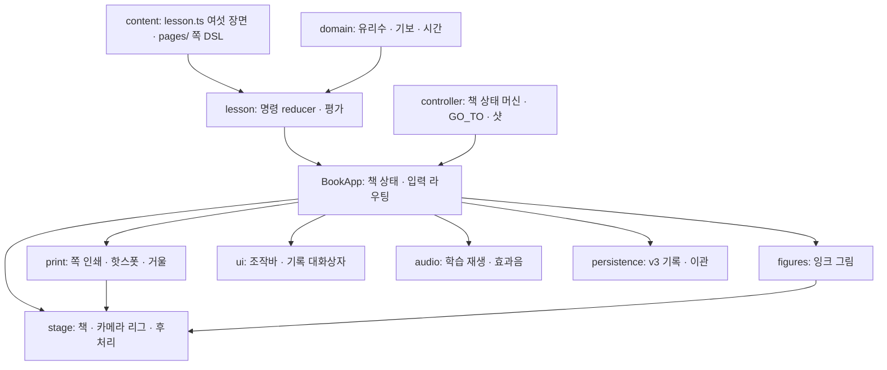

# 구현 구조 (v3)

React/TypeScript 정적 앱 하나 — 리듬 단원 `duration-basics`를 책 한 권(목차 · 레슨 1–6 · 마침)으로 읽는다. 서버·계정·결제·외부 저장소가 없다. `src/main.tsx`는 책(`src/book/entry.tsx` → `BookApp`)만 띄운다. v1 실험실 화면과 v3 비교용 legacy 렌더러는 R9에서 지웠다.

## 계층

| 계층 | 파일 | 책임 |
|---|---|---|
| 의미 | `src/domain/*`, `src/content/lesson.ts`, `src/lesson/*`, `src/scenes/durationWorld.ts` | 정확한 분수·기보·시간, 여섯 장면 내용과 평가, 음가 → 공간 의미(x = onset × 10, 폭 = 길이 × 10, 고정 높이·깊이) |
| 책 상태 | `src/book/controller.ts`, `manifest.ts`, `gesture.ts`, `turnHit.ts`, `SceneHost.ts` | 순수 reducer: 표지·넘김·드래그·대기열·숨김·2D·샷(`camera: 'shot'`)·GO_TO. 책 순서(목차 · 레슨 · 마침)와 잎(쪽 한 장의 앞뒷면), 활성 장면 1개 |
| render | `src/book/stage.ts`, `render/cameraRig.ts`·`bookFraming.ts`·`shots.ts`·`paperMaterial.ts`·`environment.ts`·`postPipeline.ts`·`flaps.ts`·`homography.ts`, `geometry.ts` | 원근 카메라 리그(fit, 샷 보간), 종이 재질(인쇄 × 잉크 + state 레이어 + 섬유), 책상·조명·그림자, GTAO·SMAA·비네트(품질 티어), 쪽 곡면·넘김 잎(풀 3장), 정답 덮개 종이 |
| print | `src/book/print/*`, `src/content/pages/*` | 쪽 DSL(`pageSpec`) → 배치(`pageLayout`) → 캔버스 인쇄(`pagePainter`, draft 768 / settled 1280) + state 레이어(`hotspots`), 인쇄 창 ≤ 48 MiB(`pageCompositor`), 접근성 거울 DOM(`AccessibleMirror`), 쪽 글꼴 서브셋(`pageFonts`) |
| figures | `src/book/figures/*`, `lessonScene.ts` | 잉크 그림: 폭이 정확한 선(`inkLines`), 해칭 종이 면(`paperFill`), 그림 빌더(`figure`), 음가 레인(`music/durationFigure`), 펼침면 장식(`music/decor`: 소리 띠·메트로놈, 가위, 초 눈금, 자유 마디), 펜 reveal·lift 안무(`choreography`) |
| ui | `src/book/ui/*`, `BookProgressTools.tsx`, `LessonPages.tsx`, `MatterPages.tsx` | 책 밖 하단 조작바, 기록·설정 모달, 표지 조작 겹침(`coverOverlay`), 2D 읽기 책(레슨 쪽은 `LessonPages`, 목차·마침은 쪽 DSL을 그리는 `MatterPages`) |
| sfx | `src/book/sfx/*`, `src/audio/AudioEngine.ts` | 절차 합성 효과음 7종, 상태 전이 → 효과음, 첫 제스처 잠금·음악 중 펜 억제. 학습 재생과 같은 AudioContext의 별도 게인 |
| 저장 | `src/persistence/*`, `useBookProgress.ts`, `BookProgressSession.ts`, `learningProgress.ts` | v3 기록(schema 3: 효과음·자동 샷 설정), v1 → v2 → v3 이관(원본 백업 → 검증 → 새 키), CAS 저장, 내보내기·가져오기·백업·삭제 |
| DEV | `src/book/inspector.ts` | 개발 서버에서만: 포즈·스냅샷·인쇄 통계·핫스폿 화면 좌표·그림·덮개·샷·넘김 시계 고정(캡처·e2e용) |

## 프레임 파이프라인 (설계서 §5.2)

1. `BookApp`이 책 상태(`book`), 학습(`lesson`), 재생(`playback`)으로 `stage.update(visual)`을 부른다. 넘김은 `turn`(GO_TO는 잎마다 진행 `leaves`), 그림은 `sceneProgress`·`sceneReveal`, 샷은 `shot`.
2. `stage.render()`: `applyObjects()`(표지 힌지, 쌓인 쪽 높이, 정지 쪽 곡면, 공중의 잎, 그림 lift, 덮개) → `fitCamera()`(읽기 포즈 fit, 샷이면 그 fit에서 샷 fit으로 `blendTo`, t = 0이면 읽기 fit 그대로) → `postPipeline.render()`.
3. 종이 재질은 `pageCompositor`의 `print`(revision마다 불변, draft → settled 교체) + `state`(선택·초점·누름·도장, 자주 바뀜) 두 텍스처를 받는다. 쪽과 그 쪽을 실은 잎은 같은 텍스처를 나눠 쓴다.
4. 포인터: `turnHit`(모서리 44 px) → 서 있는 덮개(`flapAt`) → 쪽 uv(`pagePointer`) → `hitTest`(인쇄 핫스폿) → `pickScene`(그림). 명령은 모두 기존 `LessonCommand`/`BookEvent`다. 키보드·보조기술은 같은 핫스폿을 거울 DOM으로 누른다.

## 데이터와 시간

온음표 `1/1`, 2분·4분·8분·16분음표 `1/2`…`1/16`. 이벤트는 `id`, `kind`, `onset`, `duration`, `notation`, 음표면 `pitch`. 편집 뒤 onset을 누적 합으로 다시 계산한다. 인쇄·그림·소리·평가는 같은 `LessonState` revision에서 파생한다(인쇄 키 = 장면 상태 식별). 재생은 `AudioContext.currentTime` 예약, 화면은 엔진 snapshot을 읽는다.

## 검증 도구

| 도구 | 용도 |
|---|---|
| `npm test` | 단위 테스트(의미·reducer·리그·인쇄 배치·그림·효과음·저장 이관) |
| `scripts/book-v3-e2e.ts` | 로컬 개발 서버의 실제 앱: 거울·포인터 입력, R3–R8 검사 |
| `scripts/refactor-capture.ts`, `scripts/visual-baseline.ts` | 상태별 캡처와 `metrics.json`(카메라·종이·인쇄·조작바 수치), 42칸 기준선 |
| `scripts/figure-capture.ts`, `scripts/sfx-render.ts`, `scripts/perf-budget.ts` | 잉크 그림 연속 장면·선 폭, 효과음 오프라인 렌더, 성능 예산 |
| `scripts/font-license-audit.ts` | 빌드 조건: 기보 글꼴(Bravura·Academico) OFL 고지 추출, 쪽 글꼴(Book Sans·Book Serif)의 이름 바꿈·OFL 기록 확인 |
