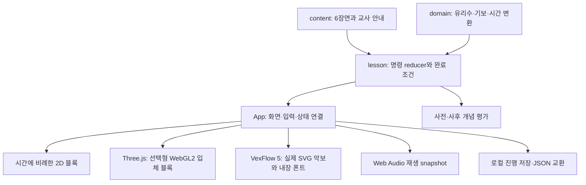

# 구현 구조

현재 구현은 React/TypeScript 정적 앱의 첫 리듬 단원 `duration-basics` 6장면이다. 서버·계정·결제·외부 저장소가 없다. 가로형 모바일 화면을 기준으로 구성하고 세로 화면에서는 영역을 세로로 재배치한다.

| 모듈 | 실제 책임 |
| --- | --- |
| `src/domain/fraction.ts` | 정규화된 유리수와 정확한 사칙연산·비교. 화면 좌표를 음악 데이터로 사용하지 않음 |
| `src/domain/music.ts` | 음가 기보, 박자 길이, `seconds(duration, {bpm, unit})`, C4=MIDI60 및 주파수 변환 |
| `src/content/types.ts`, `lesson.ts` | 6장면, 9레인, 목표·질문·교사 안내·텍스트 대체·단원 버전. 현재 단원과 ID가 명시된 타입 |
| `src/content/validation.ts` | 콘텐츠 및 이벤트 입력 검증. 초안·재생 가능한 패턴 구분과 분수 총합·쉼표·음가 종류 조건 평가 |
| `src/lesson/controller.ts` | 장면/레인 선택, 분할·인접 병합·추가·삭제·음표/쉼표 전환, undo/redo, 완료 판단, 안전한 학습 복원 |
| `src/lesson/assessment.ts`, `components/ConceptQuiz.tsx` | 사전·사후 개념 질문과 개념별 피드백. 교육 효과를 검증한 시험 도구라는 뜻은 아님 |
| `src/scenes/DurationScene2D.tsx` | onset과 duration에 비례한 시간 블록·선택 목록 |
| `src/scenes/DurationScene3D.tsx` | 실제 Three.js 0.186.1 WebGL2 장면의 지연 로딩, 고정 직교 시점 두 가지, Raycaster 탭 선택·드래그 구분, DPR 제한·필요 시 그리기, 연결 손실/초기화 실패의 2D 대체와 자원 정리 |
| `src/scenes/durationWorld.ts` | 정확한 onset·duration의 world X 좌표와 고정 높이·깊이, 공유 Geometry·Material, 속이 빈 점선 쉼표와 투명 선택 영역, 시점 구성 |
| `src/components/SceneBoundary.tsx` | 지연 3D 모듈의 로딩·렌더 오류를 받아 재생 정지 및 같은 데이터의 2D 전환으로 연결 |
| `src/notation/NotationView.tsx` | 실제 로컬 `vexflow/bravura` 5.0.0의 SVG 기보. 내장 Bravura/Academico 폰트 준비 확인, 오류 시 텍스트 목록·재시도, 이벤트 ID 기반 선택·재생 강조 |
| `src/audio/AudioEngine.ts` | 사용자 동작 후 AudioContext 준비, 불변 재생 snapshot, 음표 oscillator·gain, 쉼표의 무음 시간, 반복·정지·오류 처리 |
| `src/persistence/progress.ts` | 버전 있는 로컬 진행, 검증된 JSON 미리보기/확정, 저장 실패 시 기존 기록 유지, 이 앱 기록·백업 삭제 |
| `src/App.tsx` | 위 모듈 연결, 재생 중 편집 제한, 모드 변경/화면 이탈 시 정지, 접근 가능한 조작 UI, 교사·프로젝터·인쇄 흐름 |

## 데이터와 시간

온음표를 `1/1`로 두고 2분·4분·8분·16분음표를 각각 `1/2`, `1/4`, `1/8`, `1/16`로 저장한다. 이벤트는 안정적인 `id`, `kind`, `onset`, `duration`, `notation`과 음표인 경우 `pitch`를 가진다. 쉼표는 pitch를 가지지 않는다. 편집 후 onset을 누적 합으로 다시 계산한다.

렌더러는 동일한 이벤트를 읽는다. 2D/입체 블록의 가로 길이는 시간 비율이며 악보의 음악적 간격을 뜻하지 않는다. Three 장면은 온음표 너비 10, `x = onset × 10`, `width = duration × 10`, 고정 높이 0.38·깊이 0.9를 사용한다. 음표는 채운 상자, 쉼표는 속이 빈 점선 윤곽과 색을 쓰지 않는 선택 Mesh다. 수동 직교 시점은 X축 길이 비율을 보존하며 자동 회전은 하지 않는다.

Three 장면은 변경 시에만 한 프레임을 예약하고 DPR을 최대 1.5로 제한한다. 모션 감소 시 이동 재생선의 연속 그리기를 생략한다. 데이터 교체는 Geometry·Material을 재사용한다. 화면 해제와 초기화 실패는 예약 프레임·관찰자·리스너·공유 자원·renderer·context·Canvas를 정리한다. WebGL 부재·실제 context loss·3D 모듈 로딩 실패 시 재생을 정지하고 동일한 리듬과 학습 진행을 2D로 이어간다. 도형 좌표·선택·해제 6개 단위 검사와 실제 WebGL HTTP 9개 검사는 [Three 검수 기록](qa/Three_REVIEW.md)을 따른다.

음악적 간격·기둥·쉼표·beam은 실제 VexFlow 5가 담당한다. 온쉼표는 네 번째 보표선에서 내려 걸리고 2분쉼표는 가운데 선 위에 놓이도록 구분한다. 폰트 준비 실패 시 SVG를 준비 완료로 표시하지 않고 텍스트 대체와 명시적 재시도를 제공한다.

VexFlow는 정상 pnpm 저장소에서 전체 293개 파일을 SHA-512 검증 후 확보했다. `vexflow/bravura`에 포함된 data-URL WOFF2를 사용하며 CDN 기본 폰트 로딩을 호출하지 않는다. 프로그램 MIT와 실제 내장 Bravura/Academico/Academico Bold의 OFL 고지는 `public/licenses`에 각각 보존되어 있다. 실제 렌더 23개 확인 및 폰트 일시 실패 후 재시도 1개 확인은 별도 기보 검증 산출물이다. 음악교사 승인과 실제 인쇄/기기 검증을 대신하지 않는다.

재생 시 선택한 레인과 템포를 불변 snapshot으로 만든다. oscillator 시작·종료는 `AudioContext.currentTime`에 예약하며, 타이머는 세션 관리와 다음 반복 예약을 돕는다. UI는 엔진 snapshot을 32ms 간격으로 읽고 값이 같으면 React 상태를 갱신하지 않는다. 시작 여유 기본값은 35ms이며 실기기 지연 측정값이 아니다. 템포 변경은 정지 후 다음 재생에 반영한다. 페이지 숨김·모드 변경·가져오기 등의 경계에서 재생을 정지한다.

## 저장 경계

기본 키는 `music-theory-lab:duration-basics:progress`, 백업 키는 그 뒤의 `:backup`이다. 진행·패턴·선택 환경만 저장하고 오디오 노드·DOM·undo 이력은 저장하지 않는다. JSON은 1MiB 이하이며 지원 버전·키·분수·이벤트 연속성 등을 검증한다. 파일 선택은 미리보기만 만들고 명시적 적용 후 저장한다. 지원되지 않는 구버전은 임의 변환하지 않는다.

현재 로컬 빌드 산출물은 Vite의 `dist`와 별도의 독립 파일 `output/preview.html`이다. 사용자 승인 후 공식 npm 설치와 별도 clean npm ci가 성공했고, 허용된 로컬 production HTTP 환경의 실제 WebGL 검증이 추가되었다. 초기 CSS3D·file-only·HTTP EACCES 상태는 이전 단계의 이력이다.

최종 HTTP Three 9/9 검사의 `dist/index.html` SHA-256은 `6d4ca09b0288cdd5bdf376fbdc7168e13e432bdb919f6b6151d7f348ad08383d`다. 개별 검증 실행의 결과·해시는 [검증 표](qa/TEST_MATRIX.md), [Three 검수 기록](qa/Three_REVIEW.md), [빌드 상태](BUILD_STATUS.md)를 따른다. 이전 artifact의 검사 수를 최종 빌드 수에 중복 합산하지 않는다. 현재도 외부 서버·계정은 필요 없으며, 외부 공개 배포·실제 모바일 기기·청취·교육자 승인을 로컬 자동 검증과 동일하게 취급하지 않는다. 남은 수용 범위는 [알려진 제한](KNOWN_LIMITATIONS.md)을 확인한다.
